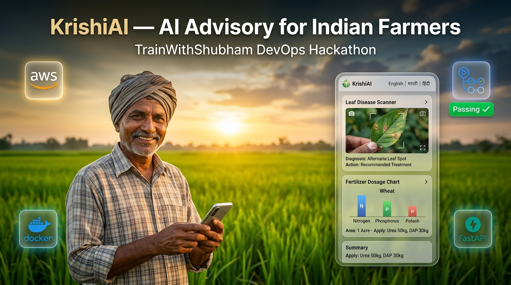

# 🌱 KrishiAI – AI-Powered Agricultural Assistant

[](https://github.com/vaishu159878/KrishiAI/actions/workflows/ci.yaml)
[](http://krishiai.ap-south-1.elasticbeanstalk.com)
[](https://d1safklmglvdi3.cloudfront.net)
[](https://aws.amazon.com/rds/)

> **Live Demo (Free HTTPS for Camera, Voice & PWA Installation):**  
> 🔗 **[https://d1safklmglvdi3.cloudfront.net](https://d1safklmglvdi3.cloudfront.net)**  
> *(Direct Elastic Beanstalk Endpoint: [http://krishiai.ap-south-1.elasticbeanstalk.com](http://krishiai.ap-south-1.elasticbeanstalk.com))*

<p align="center">
  
</p>

---

Hi everyone! 👋

I built **KrishiAI** as part of the **TrainWithShubham DevOps Hackathon**. The idea behind this project is to use artificial intelligence and production-grade DevOps engineering to empower Indian farmers with simple, accessible crop health guidance, weather insights, fertilizer calculations, and emergency advisory in their local language.

As a developer and DevOps learner, I wanted to build something that solves a genuine real-world problem for Indian agriculture while gaining deep, end-to-end hands-on practice with **containerization, CI/CD pipelines, reverse proxies, AWS cloud architecture, and database isolation**.

---

## 🚜 Why I Built KrishiAI

In rural India, farmers frequently face unexpected crop diseases, pest outbreaks, and sudden weather shifts. Getting timely expert advice can be difficult due to physical distance, language barriers, or limited agricultural extension officers.

Many farmers also find typing long technical descriptions on mobile keyboards challenging or have spotty internet in the fields.

I designed KrishiAI with **simplicity, voice-first usability, and accessibility at the center**:
1. A farmer can simply **speak** their problem in **मराठी (Marathi)**, **हिन्दी (Hindi)**, or **English**, or upload a crop photo straight from their phone camera.
2. KrishiAI identifies the disease, suggests organic and chemical remedies, and explains preventive measures.
3. The farmer can **listen** to the advice read aloud in their native tongue, check their local weather risks, and share the guidance with fellow farmers on **WhatsApp with one click**.
4. The built-in **Smart Fertilizer Calculator** calculates the exact number of 45kg/50kg commercial bags (Urea, DAP, MOP) to buy based on ICAR guidelines for their exact land size (**Acres, Gunthas, or Hectares**).

---

## ✨ Features

### 🌿 Core Agricultural & AI Capabilities
* **📷 Photo & Text Crop Analysis:** Upload a photo from the gallery or live camera, or describe symptoms to get instant AI-powered diagnoses via **Google Gemini Vision API**.
* **🎙️ Voice Input (Speech-to-Text):** Farmers don't need to type — they can tap the microphone button and speak in **Marathi, Hindi, or English**.
* **🔊 Audio Read-Aloud (Text-to-Speech):** A "Listen to Advice" button speaks the complete diagnosis and remedies in clear, natural regional language.
* **🌐 Trilingual Support:** The entire UI and AI guidance seamlessly switch between **English**, **मराठी (Marathi)**, and **हिन्दी (Hindi)**.
* **🌦️ Live Farm Weather & Advisories:** Search any Indian village or town to get live temperature, humidity, rainfall forecasts, and automated farming tips (spraying windows, fungal disease alerts) powered by Open-Meteo.
* **🧪 Smart Fertilizer & Dosage Calculator:** Computes exact commercial fertilizer bags to purchase (Neem-coated Urea 45kg, DAP 50kg, MOP 50kg) and Farm Yard Manure (FYM) based on ICAR standards. Supports Indian land units (**Acres**, **Gunthas**, **Hectares**) with split application schedules, audio playback, and 1-click WhatsApp sharing for local fertilizer shops.
* **📲 1-Click WhatsApp Share:** Instantly share formatted advice with neighbors or village farmer WhatsApp groups.
* **📞 Emergency Kisan Helpline Directory:** 1-tap call access to the Government of India's toll-free **Kisan Call Center (1800-180-1551)** and Crop Insurance Helpline (**14447**).

### ⚙️ User, Security & Data Features
* **👤 User Authentication:** Secure signup and login powered by **Argon2** password hashing and 24-hour **JWT** session tokens stored in `localStorage`.
* **📚 Saved History:** Automatically saves personal crop analyses to **AWS RDS PostgreSQL** so farmers can revisit past treatments anytime.
* **📱 Progressive Web App (PWA):** Equipped with a Web App Manifest and Service Worker — installable on Android home screens with offline caching for field use.
* **🛡️ Security & Quota Defense:**
  * Rate-limited registration (maximum 5 signups per hour per IP) to prevent spam.
  * Per-user analysis quota (20 AI analyses per 24-hour sliding window) to prevent token abuse.
  * Weather context capped to 800 characters to prevent prompt bloat.
  * Strict Nginx Content Security Policy (CSP), `X-Frame-Options: DENY`, `X-Content-Type-Options: nosniff`, and `Referrer-Policy`.

---

## 🛠️ Tech Stack

| Layer | Technologies |
| :--- | :--- |
| **Frontend** | HTML5, CSS3, Vanilla ES6+ JavaScript, Web Speech API, Service Workers (PWA) |
| **Backend** | Python 3.12, FastAPI, Pydantic, Pwdlib (Argon2), PyJWT, Psycopg2 connection pool, Uvicorn |
| **AI Integration** | Google Gemini API (`gemini-2.5-flash`) |
| **External APIs** | Open-Meteo Weather & Geocoding APIs (Open-source, non-commercial) |
| **Database** | AWS RDS PostgreSQL 16 (`db.t4g.micro` in Mumbai `ap-south-1`) |
| **Reverse Proxy** | Nginx Alpine (Prefix routing `location ^~ /api/`, Security Headers, 10MB photo upload limit) |
| **Cloud Infrastructure** | AWS Elastic Beanstalk (Amazon Linux 2023 Docker), AWS CloudFront CDN (HTTPS Edge), AWS CloudWatch |
| **CI/CD & DevOps** | GitHub Actions (Automated unit tests & Docker container build verification), Docker Compose |

---

## 🏗️ Production Cloud Architecture

```text
               [ Indian Farmer Mobile Device / PWA ]
                                 │
                                 ▼ (HTTPS / Port 443)
              ┌──────────────────────────────────────┐
              │      AWS CloudFront CDN (Edge)       │
              │  - Free HTTPS (SSL Termination)      │
              │  - Pan-India Edge POPs (Mumbai, etc) │
              │  - Dynamic API Bypass & Static Cache │
              └──────────────────┬───────────────────┘
                                 │ (HTTP / Port 80)
                                 ▼
              ┌──────────────────────────────────────┐
              │      AWS Elastic Beanstalk           │
              │      (Docker on AL2023 - Single)     │
              │                                      │
              │  ┌────────────────────────────────┐  │
              │  │        Frontend (Nginx)        │  │ ── Port 80
              │  │  - Serves PWA & Static Assets  │  │
              │  │  - Enforces Security Headers   │  │
              │  │  - Proxies /api/ requests      │  │
              │  └───────────────┬────────────────┘  │
              │                  │ (Internal Bridge) │
              │  ┌───────────────▼────────────────┐  │
              │  │        Backend (FastAPI)       │  │ ── Port 8000
              │  │  - Rate Limiting & Auth Engine │  │
              │  │  - Gemini Prompt Engine        │  │
              │  │  - ICAR Fertilizer Calculator  │  │
              │  └───────────────┬────────────────┘  │
              └──────────────────┼───────────────────┘
                                 │
                 ┌───────────────┴───────────────┐
                 ▼                               ▼
       ┌──────────────────┐            ┌──────────────────┐
       │  Google Gemini   │            │   AWS RDS PG 16  │ (ap-south-1 Mumbai)
       │  Vision AI API   │            │  (db.t4g.micro)  │ Private VPC Security Group
       └──────────────────┘            └──────────────────┘
```

---

## ⚖️ DevOps Decisions & Architecture Trade-offs

| Decision | Why It Was Chosen | Trade-offs & Alternatives Considered |
| :--- | :--- | :--- |
| **CloudFront + Single-Instance EB** | Provides free HTTPS with custom SSL termination and edge caching across India without any Application Load Balancer (ALB) cost (~$18/month). | An ALB provides multi-instance autoscaling, but for a hackathon demo and budget-conscious deployment, CloudFront + Single-Instance is 100% Free-Tier eligible and delivers sub-millisecond edge delivery. |
| **AWS RDS PostgreSQL (Mumbai `ap-south-1`)** | Collocated in the same region and VPC for ultra-low database latency. Managed backups, automated health recovery, and schema persistence. | Local PostgreSQL Docker volumes in EC2 are lost when instances cycle. RDS completely separates compute from state. |
| **Two-File Docker Compose Pattern** | `docker-compose.yml` (production base on EB, maps port 80, connects to RDS) + `docker-compose.override.yml` (local dev, runs local postgres on 5432, maps port 8081). | Eliminates environment-specific conditional scripts. Docker Compose merges files locally, while `.ebignore` excludes the override during cloud deployment. |
| **Strict Security & CSP Headers** | Configured `Content-Security-Policy`, `X-Content-Type-Options: nosniff`, and `X-Frame-Options: DENY` in Nginx. | Required refactoring inline scripts and explicitly whitelisting Open-Meteo API origins in `connect-src`. |
| **CloudWatch Billing Alert** | Configured automated CloudWatch metric alarm in `us-east-1` for charges exceeding $5.00 USD. | Proactively protects against unexpected cloud billing overages. |

---

## 📡 API Endpoints

| Method | Endpoint | Description | Auth Required |
| :--- | :--- | :--- | :--- |
| `POST` | `/api/auth/register` | Register new farmer account (Argon2 hashed, IP rate-limited) | No |
| `POST` | `/api/auth/login` | Log in and receive 24-hr JWT bearer session token | No |
| `GET` | `/api/auth/me` | Fetch currently logged-in farmer profile | Yes (JWT) |
| `DELETE` | `/api/auth/me` | Delete account and all associated farm analyses | Yes (JWT) |
| `POST` | `/api/analyze` | AI crop disease diagnosis via Gemini Vision (20/day quota) | Optional (Saves if logged in) |
| `POST` | `/api/fertilizer/calculate` | ICAR NPK & commercial bag recommendations | No |
| `GET` | `/api/weather` | Live village weather & farming spray advisories | No |
| `GET` | `/api/history` | Retrieve user's past crop analysis history | Yes (JWT) |
| `DELETE` | `/api/history` | Clear entire analysis history | Yes (JWT) |
| `DELETE` | `/api/history/{id}` | Delete a specific analysis record | Yes (JWT) |

---

## 🧪 Automated Testing & CI/CD Pipeline

KrishiAI features an automated test suite executed via `pytest` and enforced by GitHub Actions on every pull request and push to `main`:

* **Password Security:** Validates minimum length, lowercase, uppercase, digits, special characters, and prevents passwords identical to usernames or emails.
* **Rate Limiters:** Sliding window tests for login brute-force defense and per-IP registration limits.
* **Weather Rule Engine:** Validates high-humidity fungal risk alerts, rainfall spray warnings, and ideal weather conditions.
* **Fertilizer Calculator:** Verifies ICAR Recommended Doses of Fertilizer (RDF) calculations across Cotton, Rice, Sugarcane, Wheat, Soybean, and Maize, including unit conversions for Gunthas and Hectares.
* **Gemini Error Handling:** Classifies transient (429, 503, timeouts) vs permanent (400, 401) errors for exponential backoff retries.

To run tests locally:
```bash
pip install -r backend/requirements-dev.txt
pytest -v
```

---

## 🚀 How to Run the Project Locally

### Prerequisites
* [Docker Desktop](https://www.docker.com/products/docker-desktop/) installed and running
* A [Google Gemini API Key](https://aistudio.google.com/)

---

### Running with Docker Compose (Two-File Setup)

1. **Clone the repository:**
   ```bash
   git clone https://github.com/vaishu159878/KrishiAI.git
   cd KrishiAI
   ```

2. **Configure Environment Variables:**
   Copy the example environment file inside `backend/`:
   ```bash
   cp backend/.env.example backend/.env
   ```
   Open `backend/.env` and add your keys:
   ```env
   AI_API_KEY=your_gemini_api_key_here
   GEMINI_MODEL=gemini-2.5-flash
   JWT_SECRET_KEY=your_secure_random_jwt_secret_key
   ```

3. **Start the application:**
   ```bash
   docker compose up --build
   ```

4. **Access the application:**
   * 🌐 **Frontend (Web App):** [http://localhost:8081](http://localhost:8081)
   * 📡 **Backend API Docs (Swagger):** [http://localhost:8000/docs](http://localhost:8000/docs)
   * 🗄️ **Local PostgreSQL Database:** `localhost:5432`

---

## 🔒 Privacy & Honesty Note

* **Advisory Disclaimer:** AI-generated diagnoses and fertilizer calculations are intended as informational guidance and decision support. Farmers should cross-verify severe crop pest infestations with local Krishi Vigyan Kendra (KVK) agricultural scientists before applying chemical pesticides.
* **Voice Privacy:** Voice input utilizes the browser's native Web Speech API. Audio is processed directly in the client browser / operating system engine; no voice recordings are stored or retained on KrishiAI servers.
* **Weather Attribution:** Weather forecast and geocoding data are provided by [Open-Meteo.com](https://open-meteo.com/) under the CC BY 4.0 license.

---

## 🗺️ Project Roadmap & Hackathon Milestones

- [x] Multi-language crop disease analysis (Google Gemini Vision API)
- [x] Regional Voice Input (Speech-to-Text) & Audio Read-Aloud (Text-to-Speech)
- [x] Real-time village weather alerts & spray advisories (Open-Meteo)
- [x] AWS RDS PostgreSQL 16 database integration & user analysis history
- [x] 1-Click WhatsApp advice sharing & Kisan Emergency Helplines
- [x] Smart Fertilizer & Dosage Calculator (ICAR standards, Acres/Gunthas/Ha)
- [x] Two-file Docker Compose architecture (`docker-compose.yml` + override)
- [x] Security hardening: Non-root Docker, Argon2 hashing, per-IP rate limiting, strict CSP headers
- [x] Progressive Web App (PWA) with offline shell & service worker caching
- [x] Automated CI/CD pipeline using GitHub Actions with 16 `pytest` unit tests
- [x] Cloud deployment to **AWS Elastic Beanstalk** (Docker on AL2023 in Mumbai `ap-south-1`)
- [x] Free HTTPS SSL & edge distribution via **AWS CloudFront**
- [x] CloudWatch billing alerts ($5.00 USD threshold)

---

## 🙌 Acknowledgements

* A big thank you to **TrainWithShubham** and the DevOps Hackathon community for this incredible learning platform.
* Weather data powered by [Open-Meteo](https://open-meteo.com/).
* AI capabilities powered by [Google Gemini](https://ai.google.dev/).

---

*Made with ❤️ for Indian Farmers. If you have suggestions or feedback, feel free to connect!* 🌱